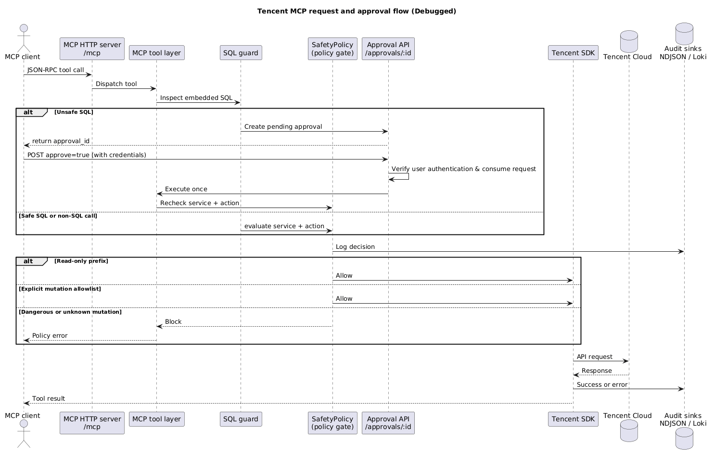
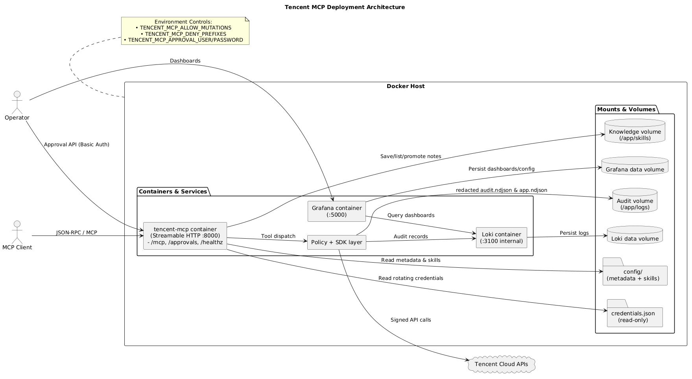

# Tencent MCP Architecture and Mutation Controls

## Overview

Tencent MCP exposes Tencent Cloud APIs through an MCP client over Streamable
HTTP. Every Tencent API request passes through one policy gate before reaching
the Tencent SDK. Requests are logged and audited whether they succeed, fail,
or are blocked.

## Architecture and data flow



## Deployment component diagram

The default Docker Compose deployment is a single `tencent-mcp` container.
MCP, Grafana, and Loki run inside that container; only MCP port `8000` and
Grafana port `5000` are published to localhost.



## Mutation controls

Policy evaluation occurs in this order. Readonly and deny prefix checks are
case-insensitive; allowlist matching is exact:

1. **Readonly prefixes** — actions beginning with `Describe`, `Get`, `List`,
   `Query`, `Check`, and similar configured prefixes are allowed automatically.
2. **Deny prefixes** — actions beginning with `Delete`, `Destroy`, `Terminate`,
   `Drop`, `Remove`, `Stop`, `Cancel`, and similar prefixes are blocked.
3. **Allowlisted mutations** — an exact `service:Action` or
   `service:*` entry in `TENCENT_MCP_ALLOW_MUTATIONS` is allowed.
4. **Everything else** — blocked by default.

Because readonly prefixes are evaluated first, an action matching both a
readonly and deny prefix is treated as readonly. Dangerous actions should
therefore not be added to readonly prefixes.

**Yes: a deny prefix overrides the mutation allowlist.** An action that matches
both `TENCENT_MCP_DENY_PREFIXES` and `TENCENT_MCP_ALLOW_MUTATIONS` is blocked,
because deny-prefix evaluation happens before the allowlist. The only earlier
rule is a readonly-prefix match.

### Environment variables

| Variable                        | Purpose                                                                              |
| ------------------------------- | ------------------------------------------------------------------------------------ |
| `TENCENT_MCP_APPROVAL_USER`     | Username required for human approval endpoints.                                      |
| `TENCENT_MCP_APPROVAL_PASSWORD` | Password required for human approval endpoints.                                      |
| `TENCENT_MCP_ALLOW_MUTATIONS`   | Comma-separated mutation allowlist, for example `cos:putObject,wedata:CreateTask`.   |
| `TENCENT_MCP_DENY_PREFIXES`     | Comma-separated dangerous action prefixes. A configured value replaces the defaults. |

These are startup configuration values. Restart the MCP container after
changing them. They do not grant Tencent permissions; CAM/IAM still controls
what the Tencent credentials can actually execute.

## How service/action rules are written

Mutation rules use this exact form:

```text
service:Action
```

Examples:

```text
wedata:CreateWorkflow
cos:putObject
cvm:RunInstances
```

The left side is the Tencent SDK service name passed to `call_tencent_api`.
The right side is the API action/method name. The rule is evaluated against
the requested pair as `service + ":" + action`; it is not a free-form phrase
and it is not an action-only rule.

`TENCENT_MCP_ALLOW_MUTATIONS` accepts comma-separated entries:

```bash
# Allow one exact service/action pair
TENCENT_MCP_ALLOW_MUTATIONS=wedata:CreateWorkflow

# Allow several pairs
TENCENT_MCP_ALLOW_MUTATIONS=wedata:CreateWorkflow,cos:putObject,cvm:RunInstances

# Allow every action for one service (use sparingly)
TENCENT_MCP_ALLOW_MUTATIONS=cos:*
```

An allowlist entry also accepts the simple singular/plural variant:
`wedata:CreateWorkflow` matches `CreateWorkflows`, and vice versa. It does not
perform general wildcard or fuzzy matching. Apart from `service:*`, use the
exact service and action spelling returned by `list_service_actions`.

Service matching is exact. Readonly and deny **prefix** matching is
case-insensitive; allowlist service/action matching is exact, so keep the
configured spelling consistent with the SDK.

### Complete evaluation algorithm

For a request such as `wedata:CreateWorkflow`, `SafetyPolicy.decide()` does
the following:

1. If the action starts with a configured readonly prefix, allow it as
   `readonly: true`.
2. Otherwise, if it starts with a configured deny prefix, block it.
3. Otherwise, if the exact `service:Action`, its singular/plural variant, or
   `service:*` is in `TENCENT_MCP_ALLOW_MUTATIONS`, allow it as a mutation.
4. Otherwise, block it because the policy is deny-by-default.

Every allowed or blocked request then passes through `checkedCall`, which
logs the decision and writes an audit record. A blocked request never reaches
the Tencent SDK. An allowlisted request still needs the corresponding
Tencent CAM/IAM permission.

The implementation is in [`src/policy.ts`](../src/policy.ts), the central
request gate is [`src/guard.ts`](../src/guard.ts), and the compose example is
in [`docker-compose.yml`](../docker-compose.yml). The `wedata:CreateWorkflow`
entry is written in the compose `TENCENT_MCP_ALLOW_MUTATIONS` environment
value; `.env.example` leaves the override empty so the code defaults apply.

## Rules of thumb

- Write mutation permissions as `service:Action`, for example
  `wedata:CreateWorkflow`.
- Start with one exact action; prefer this over `service:*`.
- Treat `service:*` as a high-risk administrative exception.
- Never rely on the allowlist to override a deny prefix; deny wins.
- Do not add destructive actions to readonly prefixes; readonly is evaluated
  first and would allow them.
- If a custom `TENCENT_MCP_DENY_PREFIXES` or
  `TENCENT_MCP_ALLOW_MUTATIONS` value is supplied, it replaces the built-in
  list; include every desired entry explicitly.
- Use `list_tencent_services` and `list_service_actions` to verify service and
  action names before adding a rule.
- Remember that MCP policy is only an application guardrail; CAM/IAM remains
  the final Tencent authorization layer.

## Human approval for mutating SQL

Unsafe SQL is not enabled by the mutation allowlist. The MCP server creates a
temporary approval request and returns an approval ID. An operator must:

1. Authenticate with Basic Auth using `TENCENT_MCP_APPROVAL_USER` and
   `TENCENT_MCP_APPROVAL_PASSWORD`.
2. Inspect `GET /approvals/:id` if required.
3. Submit `POST /approvals/:id` with `{"approve":true}`.

Approval requests expire after five minutes and are consumed after one
execution. If approval credentials are missing, the approval endpoint is
unavailable and the SQL operation cannot proceed.

> **Security:** Use a strong, secret approval password. Do not commit it to
> source control or include it in diagrams, screenshots, or logs.

## Supported Tencent services

`list_tencent_services` returns the services available in the installed
`tencentcloud-sdk-nodejs` package, plus COS. The current image exposes 260
service modules:

```text
aai, aca, acp, adp, advisor, af, afc, ags, ai3d, aiart, alb, ame, ams,
anicloud, antiddos, ape, api, apigateway, apis, apm, as, asr, asw, ba,
batch, bda, bdrc, bh, bi, billing, bizlive, bm, bma, bmeip, bmlb, bmvpc,
bpaas, bri, bsca, btoe, ca, cam, captcha, car, cat, cbs, ccc, cdb, cdc,
cdn, cds, cdwch, cdwdoris, cdwpg, cdz, cetcd, cfg, cfs, cfw, chc, chdfs,
ciam, cii, cim, ckafka, clb, cloudapp, cloudaudit, cloudhsm, cloudmate,
cloudrc, cloudstudio, cls, cme, cmq, cms, cngw, config, controlcenter,
cos, cpdp, csip, csxg, ctem, ctsdb, cvm, cwp, cws, cynosdb, dasb, dataagent,
dayu, dbbrain, dbdc, dbs, dc, dcdb, dlc, dnspod, domain, drm, ds, dsgc,
dts, eb, ecc, ecdn, ecm, eiam, eis, emr, es, ess, essbasic, evt, facefusion,
faceid, fmu, ft, fwm, ga2, gaap, gme, goosefs, gs, gwlb, habo, hai, hasim,
hcm, hunyuan, iai, iap, ic, icr, ie, ig, igtm, ims, ioa, iot, iotcloud,
iotexplorer, iotvideo, iotvideoindustry, irp, iss, ivld, keewidb, kms,
lcic, lighthouse, live, lke, lkeap, lowcode, mall, mariadb, market, memcached,
mmps, mna, mongodb, monitor, mps, mqtt, mrs, ms, msp, nlp, npp, oceanus,
ocr, omics, organization, partners, portal, postgres, privatedns, pts, rce,
redis, region, rum, scf, securitylake, ses, smh, smop, sms, soe, sqlserver,
ssa, ssl, sslpod, ssm, sts, svp, taf, tag, tat, tbaas, tbp, tcaplusdb, tcb,
tcbr, tccatalog, tchd, tcm, tcr, tcss, tdai, tdcpg, tdid, tdmq, tdmysql,
tds, tem, teo, thpc, tia, tiia, tione, tiw, tke, tkgdq, tms, tmt, tokenhub,
tourism, trabbit, trocket, trp, trro, trtc, tse, tsf, tsi, tsw, tts, vcg,
vclm, vcube, vdb, vm, vms, vod, vpc, vrs, vtc, waf, wav, wedata,
weilingwith, wimgs, wsa, wss, yinsuda, yunjing, yunsou
```

The list is runtime-derived, so it can change when the container image
updates its SDK. Use `list_service_actions` to discover API versions and
actions for a specific service. `call_tencent_api` is the generic entry point;
the safety policy still applies to every action.

## MCP-native capabilities

In addition to direct Tencent APIs, the server provides:

| Capability             | Purpose                                                                                        |
| ---------------------- | ---------------------------------------------------------------------------------------------- |
| `get_caller_identity`  | Validate credentials and show the Tencent account identity through STS.                        |
| `run_dlc_sql`          | Submit and monitor DLC SQL; safe read SQL runs directly, while mutating SQL requires approval. |
| `run_wedata_workflow`  | Trigger and monitor WeData workflows and collect failure evidence/RCA details.                 |
| `get_audit_policy`     | Display active readonly prefixes, deny prefixes, and mutation allowlist.                       |
| `get_metadata_context` | Read configured defaults such as region, WeData project/workflow, and DLC engine/database.     |
| `save_knowledge`       | Add a Markdown lesson to the MCP-managed `refined` or `unrefined` knowledge base.              |
| `list_knowledge`       | Browse knowledge-base notes, optionally filtered by status.                                    |
| `promote_knowledge`    | Move a validated unrefined note into the refined knowledge base.                               |

Knowledge notes are stored under the configured knowledge directory, normally
`/app/skills/{refined,unrefined}` in Docker. They are discovered by
`GET /mcp/readme` and can be updated without restarting the server.
